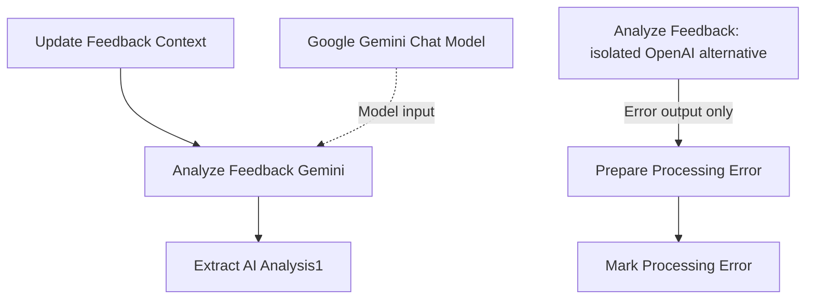

# Node-by-node workflow guide

This guide explains all **42 saved nodes** in the existing project: 11 in the request workflow and 31 in the feedback-processing workflow. Names match the checked-in JSON exactly, including names ending in `1` and retained unsuffixed alternatives.

Reviewed against [source snapshot `3405c6f`](https://github.com/jasperosas/reputation-feedback-intelligence-engine/tree/3405c6fb5049de4c747095eb0848b16a26432556) on 5 November 2026. The guide describes saved configuration and wiring. It does not claim that each node has been executed after restoration.

## Reading the saved state

- A **connected** node belongs to a path wired from a trigger, or supplies the model used by that path. It is not proof of a successful run.
- A **disabled** node has `disabled: true` in the export. Disabled entry triggers prevent automatic entry through those triggers.
- A **retained alternative** exists in the JSON but is not reached from the customer-form path. It may still be enabled individually.
- The sanitized exports disable their entry triggers, but the Gmail send nodes are still enabled in the JSON. Keep Gmail disabled in a restoration copy during no-email checks. Do not interpret a disabled sender's pass-through output as proof of sending or let it create a false `Sent` record.
- A replay of stored analysis scores verifies routing calculations only. It does not run a model, deliver mail or establish a fresh end-to-end n8n result.

## Workflow 1: Send feedback request

Source: [`workflows/send-feedback-request.json`](workflows/send-feedback-request.json). **11 nodes.**

The staff-form path creates and stores a visit before preparing its feedback request. The separate disabled spreadsheet-trigger path first checks whether an existing visit is eligible. Both paths share the request-preparation and status-update steps.

| Exact node name | Node type | Reads | Action and next step |
| --- | --- | --- | --- |
| `Staff Visit Form` | Form Trigger | Staff-entered customer, location, service and manager details. | Starts the staff visit path and passes submitted fields to `Find Existing Customer`. This trigger is disabled in the sanitized export. |
| `Find Existing Customer` | Google Sheets: read | The form's `customer_email`. | Searches `Visits` for that email. Matching rows go to `Prepare Staff Visit`. `alwaysOutputData` is enabled so an empty lookup can still reach the preparation step. |
| `Prepare Staff Visit` | Code (JavaScript) | The staff form and customer lookup results. | Reuses the first available matching `customer_id`, or creates a timestamp-based ID. Creates `visit_id`, an opaque `feedback_token`, completion time and the visit fields. Sets `job_status` to `Complete` and request status to `Sending`, then passes one prepared visit to `Add Staff Visit to Visits`. |
| `Add Staff Visit to Visits` | Google Sheets: append | The prepared visit object. | Appends the visit and token to `Visits`, then enters the shared request path at `Prepare Feedback Request`. |
| `Google Sheets Trigger` | Google Sheets Trigger | Configured changes to the `Visits` worksheet. | Provides a separate entry point for spreadsheet events and passes a row to `Ready to Request Feedback`. It is disabled in the saved export. |
| `Ready to Request Feedback` | IF | `job_status` and `feedback_request_status`. | Allows a row only when the values are exactly `Complete` and `Not sent`. True goes to `Prepare Feedback Request`; False has no connected next step. This check belongs to the spreadsheet-trigger path; the staff-form path joins after it. |
| `Prepare Feedback Request` | Edit Fields / Set | The visit, customer fields and `feedback_token`. | Builds the email context and token-based `feedback_link`, then passes the item to `Mark Feedback Request as Sending`. It also prepares a `Sent` label and timestamp before Gmail runs; those prepared values alone are not delivery evidence. The form URL remains a placeholder in the sanitized file. |
| `Mark Feedback Request as Sending` | Google Sheets: update | The prepared `visit_id`. | Matches the visit by `visit_id` and writes the literal request status `sending` before passing data to Gmail. The lowercase value differs from the documented `Sending` dropdown option and needs review during restoration. |
| `Send Feedback Request` | Gmail | Customer name, email and feedback link from `Prepare Feedback Request`. | Sends the feedback-request email to the prepared customer address and passes its result to `Prepare Request Sent Status`. This is a real send operation when configured and executed; the node itself is not disabled in the archived JSON. |
| `Prepare Request Sent Status` | Edit Fields / Set | The post-Gmail item and original prepared `visit_id`. | Prepares `feedback_request_status = Sent` and the current ISO timestamp after the Gmail step returns, then passes these fields to `Mark Feedback Request Sent`. |
| `Mark Feedback Request Sent` | Google Sheets: update | `visit_id`, request status and sent timestamp. | Updates the matching `Visits` row with the sent status and time. Its configured write mapping contains these three fields; it is the final step of this path. |

### Fields that connect this workflow

| Field | Role |
| --- | --- |
| `customer_email` | Lookup key used to find an existing customer. A shared or changed email can make identity matching ambiguous. |
| `customer_id` | Stable customer reference that later links feedback history across visits. |
| `visit_id` | Identifies the visit to append or update. |
| `feedback_token` | Opaque lookup value placed in the feedback link and later matched to a visit. The archived generator uses `Date.now()` and `Math.random()` and does not implement expiry. |
| `feedback_request_status` | Tracks eligibility and send progress. Preserve exact status values expected by the sheet. |
| `manager_email` | Stored visit context used by Workflow 2 for an escalation destination. |

## Workflow 2: Receive customer feedback

Source: [`workflows/receive-customer-feedback.json`](workflows/receive-customer-feedback.json). **31 nodes: 22 on the connected processing/model paths and 9 retained alternatives or error-component nodes.**

### Connected intake, analysis and follow-up nodes

| Exact node name | Node type | Reads | Action and next step |
| --- | --- | --- | --- |
| `Customer Feedback Form` | Form Trigger | Submitted `feedback_text` and `feedback_token`. | Starts intake and passes the submission to `Feedback Token Present`. The trigger is disabled in the sanitized export. |
| `Feedback Token Present` | IF | The submitted `feedback_token`. | Tests whether the token is non-empty. In the saved graph, both True and False go to `Get Matching Visit`. It therefore does not currently stop missing-token submissions. |
| `Get Matching Visit` | Google Sheets: read | The token from `Customer Feedback Form`. | Searches `Visits` by `feedback_token` to obtain stored customer, visit, service, location and manager context. Its output goes to `Save Original Feedback`. Because `alwaysOutputData` is enabled, a separate check is still needed to require exactly one valid visit match. |
| `Save Original Feedback` | Google Sheets: append | The matching visit and the original form message. | Creates a timestamp-based `feedback_id`, saves the original message and visit/customer fields in `Feedback`, and initializes processing and follow-up statuses. The raw message is stored before model analysis. Output goes to `Prepare Feedback Context`. |
| `Prepare Feedback Context` | Edit Fields / Set | The saved feedback row, matching visit and original form. | Combines `feedback_id`, visit/customer fields, service, manager address and the original message for later steps. It passes context to `Update Feedback Context`. Two exported assignment names have leading equals signs: `=feedback_id` and `=visit_id`; confirm their intended field names when restoring. |
| `Update Feedback Context` | Google Sheets: update | The prepared context, matched by `feedback_id`. | Writes the visit/customer context and message to the existing `Feedback` row, sets `processing_status` to `Processing`, and passes the item to `Analyze Feedback Gemini`. |
| `Google Gemini Chat Model` | Gemini model sub-node | Model configuration for the connected analysis chain. | Supplies the Gemini model through the chain's `ai_languageModel` connection. It is a model provider, not a separate routing decision. The saved model identifier is `models/gemini-3.5-flash-lite`; this records the export's setting, not a fresh availability check. |
| `Analyze Feedback Gemini` | Basic LLM Chain | `feedback_text` from the prepared context and the Gemini model connection. | Requests JSON containing `sentiment_label`, `sentiment_score`, `severity_score`, `confidence` and `summary`. The prompt asks for analysis only, not routing or a customer reply. Normal output goes to `Extract AI Analysis1`. It has an error-output setting, but no error connection is saved for this node. |
| `Extract AI Analysis1` | Edit Fields / Set | The Gemini chain's text response plus saved feedback/context references. | Removes Markdown JSON fences, parses the response and exposes its analysis fields alongside `feedback_id`, `customer_id`, message and location. Output goes to `Save AI Scores`. Invalid JSON can fail here; no full response-schema validation is configured in this extractor. |
| `Save AI Scores` | Google Sheets: update | The extracted analysis and original context, matched by `feedback_id`. | Stores sentiment label, sentiment score, severity and confidence with the row's context. Sets `processing_status` to `Processing` and resets several follow-up statuses to `Not required`. Its saved mapping does not persist the analysis `summary`. Output goes to `Get Customer Feedback History1`. |
| `Get Customer Feedback History1` | Google Sheets: read | `customer_id` from `Extract AI Analysis1`. | Fetches that customer's feedback rows from `Feedback`, then passes the returned history to `Count Previous Negative Feedback1`. |
| `Count Previous Negative Feedback1` | Code (JavaScript) | The fetched history and the current extracted analysis. | Excludes the current `feedback_id` and counts returned rows whose numeric `sentiment_score` is below zero. Adds `prior_negative_count` to the current analysis and passes one item to `Route Feedback`. The code has no timestamp cutoff, so replaying an older record can include later feedback in the count. |
| `Route Feedback` | Switch: expression | Confidence, sentiment label/score, severity and prior-negative count. | Returns one output index from 0 to 3 using the ordered rules below. It routes to human review, manager escalation, private queue or ready-to-post tracking. Routing is decided by this expression, not by an AI-generated instruction. |
| `Mark Human review` | Google Sheets: update | Switch output 0 and its `feedback_id`. | Writes route `Human review`, a route reason and the prior-negative count. Sets both `review_status` and `processing_status` to `Needs review`. This branch ends here. |
| `Mark Manager Escalation` | Google Sheets: update | Switch output 1 and its `feedback_id`. | Writes `Manager escalation` and its reason. Marks the draft and alert delivery as `Pending`, the alert as `Open`, the customer response as `Not sent`, and review/processing as `Needs review`. It starts two separate branches: `Generate Response Draft` and `Send Manager Alert1`. |
| `Mark Private Queue` | Google Sheets: update | Switch output 2 and its `feedback_id`. | Writes `Private queue`, its reason and prior-negative count. Marks the draft `Pending`, response `Not sent`, alerts `Not required` and processing `Needs review`, then starts `Generate Response Draft`. In this node, the text `Needs review` is written to `reviewer_notes`, not `review_status`. |
| `Mark Ready to Post` | Google Sheets: update | Switch output 3 and its `feedback_id`. | Writes route `Ready to post`, a reason, the prior-negative count and `processing_status = Complete`. This branch ends here. It records a queue status; it does not publish a review. |
| `Generate Response Draft` | OpenAI | Customer name, service and original feedback text from `Prepare Feedback Context`. | Uses the configured `gpt-4.1` model to draft a customer-service response. The system prompt describes tone and limits on unsupported promises. The current user prompt passes name, service and message, rather than all available score/history fields. Output goes to `Save Response Draft1`; the draft is not sent to the customer. |
| `Save Response Draft1` | Google Sheets: update | The OpenAI response text and feedback ID from `Extract AI Analysis1`. | Writes `response_draft`, sets `draft_status = Ready for review`, keeps `response_status = Not sent` and sets `review_status = Needs review`. This draft branch ends here. |
| `Send Manager Alert1` | Gmail | Manager address from `Get Matching Visit`, visit context, scores and complaint-history count. | Sends the escalation alert on the manager branch, then passes its result to `Prepare Alert Status1`. It does not send the customer response draft. The archived Gmail node itself is enabled. |
| `Prepare Alert Status1` | Edit Fields / Set | The post-alert item and feedback ID from `Extract AI Analysis1`. | Prepares `alert_delivery_status = Sent`, `alert_status = Open` and an ISO sent timestamp, then passes these fields to `Mark Alert Sent`. `Open` means the case still needs management attention. |
| `Mark Alert Sent` | Google Sheets: update | The prepared feedback ID, delivery status, alert status and timestamp. | Updates the matching `Feedback` row with the alert-delivery result. It records delivery state; it does not confirm that a manager resolved the complaint. |

### Routing order

The Switch applies the following tests in order and uses the first matching result. Scores must be numeric; confidence and severity use a 0-to-1 scale. A percentage-formatted spreadsheet cell can display `95%` while storing `0.95`; preserve the underlying numeric value when reading it.

| Priority | Condition | Output | Destination |
| --- | --- | ---: | --- |
| 1 | `confidence < 0.70` | 0 | `Mark Human review` |
| 2 | `prior_negative_count > 0` and `sentiment_score < 0` | 1 | `Mark Manager Escalation` |
| 3 | `sentiment_label` is `Negative` and `severity_score >= 0.70` | 1 | `Mark Manager Escalation` |
| 4 | Any remaining `Negative` label | 2 | `Mark Private Queue` |
| 5 | `Positive` label and `severity_score < 0.70` | 3 | `Mark Ready to Post` |
| 6 | Anything unmatched, including neutral feedback | 0 | `Mark Human review` |

Low confidence therefore takes priority even when a complaint is severe or has negative history. Exactly `0.70` confidence is not below the review threshold; exactly `0.70` severity meets the serious-negative threshold.

### Retained alternatives and isolated error component

These nine nodes remain in the archive for traceability. Do not describe them as the connected sentiment-analysis path.

| Exact node name | Node type | Intended purpose | Saved connection state |
| --- | --- | --- | --- |
| `Analyze Feedback` | OpenAI | Configured alternate sentiment-analysis node using `gpt-4o` and a strict JSON schema for the five analysis fields. | No incoming connection from the customer-intake path. Its normal output is empty; its error output goes to `Prepare Processing Error`. It is not the connected analysis provider in this export. |
| `Extract AI Analysis` | Edit Fields / Set | Extracts OpenAI-style structured output and joins it to saved feedback/context fields. | No incoming connection and no connected next step. It is retained separately from the connected Gemini extractor `Extract AI Analysis1`. |
| `Get Customer Feedback History` | Google Sheets: read | Looks up feedback history using the older OpenAI extractor's `customer_id`. | No incoming connection or connected next step. The connected counterpart is `Get Customer Feedback History1`. |
| `Count Previous Negative Feedback` | Code (JavaScript) | Older counter that excludes the current feedback ID and counts other negative-score history rows. | Disabled and disconnected. It references `Extract AI Analysis`; the connected version is `Count Previous Negative Feedback1`. |
| `Send Manager Alert` | Gmail | Older escalation email template using the unsuffixed extractor and negative-history counter. | No incoming connection or connected next step. It is enabled in the JSON but is outside the form-connected graph. The wired alert is `Send Manager Alert1`. |
| `Save Response Draft` | Google Sheets: update | Older draft writer, matched using the unsuffixed `Extract AI Analysis` feedback ID. | No incoming connection and no saved outgoing edge. The wired draft writer is `Save Response Draft1`. |
| `Prepare Alert Status` | Edit Fields / Set | Older alert-status preparation using the unsuffixed extractor. | No incoming connection or connected next step. The wired version is `Prepare Alert Status1`. |
| `Prepare Processing Error` | Edit Fields / Set | Builds the current feedback ID, error message, review status and failure status from an analysis error. | Receives only the isolated `Analyze Feedback` error output, then feeds `Mark Processing Error`. Its saved failure value is misspelled `Failled`. This component is unreachable from the customer form in the archived graph. |
| `Mark Processing Error` | Google Sheets: update | Writes the prepared failure status, `Needs review` and error message to the matching feedback row. | Connected only after `Prepare Processing Error`. Its existence does not provide error handling for the connected Gemini path or for every Sheets/Gmail operation. |

### Which model does what

Gemini is connected for feedback analysis. OpenAI is separately connected for `Generate Response Draft`. The isolated OpenAI analysis component is different from that draft path. The separately described OpenAI-analysis recovery remains untested until that specific restored configuration is imported and executed.

## Restoration points visible in the source

| Source detail | Why it matters |
| --- | --- |
| Both outputs of `Feedback Token Present` reach the lookup. | Missing tokens are not rejected by the saved gate. A non-empty token also needs a unique visit-match check. |
| `Get Matching Visit` has `alwaysOutputData` enabled. | A lookup returning no matching visit can still pass an empty item onward; do not assume a valid visit was found. |
| Context assignment names include `=feedback_id` and `=visit_id`. | Confirm the restored field names match the sheet headers and downstream expressions. |
| The in-progress request status is saved as `sending`. | The documented/native status option is `Sending`; reconcile the mapping before sending anything. |
| Gemini has an error-output setting but no saved error edge. | The old OpenAI error component does not handle a failure on the connected Gemini analysis path. |
| The Gemini extractor calls `JSON.parse` directly. | Empty, malformed or unexpected model output needs an explicit validation/error path. |
| Error preparation writes `Failled`. | Correct the failure value in a restoration copy to match the intended `Failed` status. |
| The history counter excludes the current ID but has no date filter. | Retrospective reprocessing can count later records as previous complaints. |
| Many expressions use `.first()`. | The archive is shaped around one submission at a time. Test record pairing before using it as a batch processor. |
| Route and follow-up statuses are written by different nodes. | A saved route does not prove a response draft was saved, an alert was delivered or a manager resolved the case. |

These findings describe the unchanged archival workflow exports. Repairs were applied in separate no-email test copies, not in those archive files. Keep existing records and customer details in private working resources; no record contents, addresses, spreadsheet IDs or tokens are needed in this guide.

## Verification boundary

The node counts, field mappings, saved disabled flags and named connections were checked directly against the two JSON exports. Runtime credentials, current model availability, provider response shapes, email delivery and error-path behavior require separate execution evidence. See [README.md](README.md) for project status and [SECURITY.md](SECURITY.md) for handling the archived exports.

## Separate restoration test copies — 6 November 2026

The original 42-node guide above remains an archive reference. New [request](workflows/test-send-feedback-request.json) and [receiving](workflows/test-receive-customer-feedback.json) test copies contain 15 and 36 nodes respectively, including manual private-input adapters and safety guards. Both are inactive, and every Gmail node is disabled. Their public private-input adapters stop until configured locally.

Verified runtime results are limited to the no-email request path, positive/neutral stored-score replays, missing-token rejection and the configured Gemini-failure handler. The latter records `Failed` and `Needs review` when the tested model has no credential. Replay is not fresh analysis. OpenAI drafting and Gmail delivery remain unverified.

See [TESTING.md](TESTING.md) for each repair, its verification scope, redacted screenshots, 29 local code/graph checks and the unverified boundaries. The private workbook's new `summary` column is free text; the public JSON retains placeholder spreadsheet IDs and no credentials or record contents.
