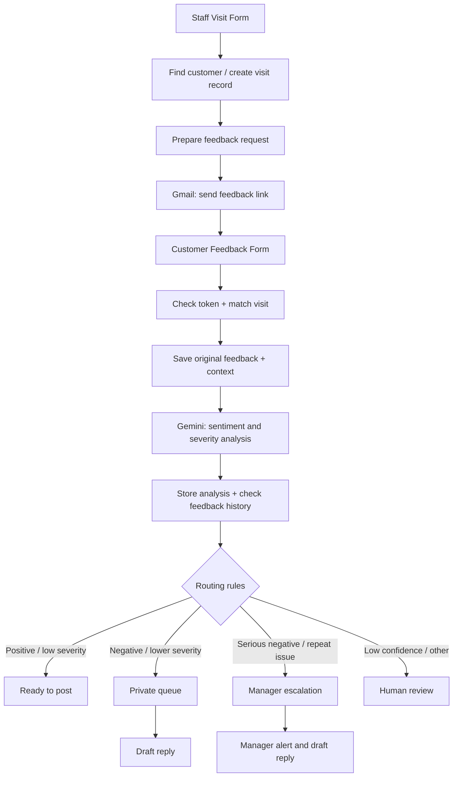
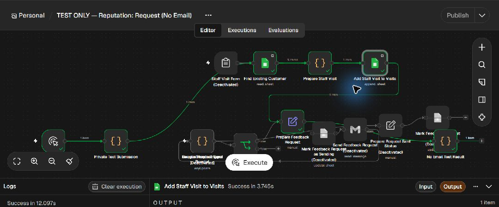

# Reputation & Feedback Intelligence Engine

**TS Academy AI & Automation Capstone · Portfolio archive (2026)**

Two interconnected n8n workflows for a multi-location service business. Together, they demonstrate requesting customer feedback, linking it to visit records, processing responses, and routing cases for review or follow-up with **Gemini-assisted analysis**.

**Status — 6 November 2026:** Original exports are preserved as a historical archive. Separate repaired, inactive **no-email test workflows** have now been executed locally against an **owner-only private copy of existing project records**. Verified results include a request/visit write, positive and neutral **stored-score replays**, missing-token rejection, and AI-failure status logging. **Fresh Gemini analysis, OpenAI drafting and Gmail delivery remain unverified.** See [TESTING.md](TESTING.md).

## Blank Google Sheets template

Download [the blank workbook](templates/reputation-blank-template.xlsx), upload it to Google Drive, open it with Google Sheets, then choose **File → Save as Google Sheets** if it opens in Office editing mode. It contains header-only `Visits` (12 fields) and `Feedback` (27 fields) tabs, including the free-text `summary` column. Header-only CSVs are available for [Visits](templates/visits-headers.csv) and [Feedback](templates/feedback-headers.csv).

This is a fresh schema-only template with no customer records, tokens, credentials, hidden data or dashboard formulas. Unused `Column 1`–`Column 14` placeholders from the archived workbook are omitted. The workflows use the named fields. No validation is applied to `summary`.

Keep tab names and headers unchanged. An empty workbook has no visits to match; receiving requires exactly one matching token-bearing visit. The documented existing-record tests used a separate owner-only private copy, not this blank template. Configure sheet IDs and records privately, keep both test workflows inactive and all Gmail nodes disabled. Creating this template does not extend the verified runtime results in [TESTING.md](TESTING.md).

## Architecture



The diagram simplifies the flow for readability; refer to the JSON exports for the complete node wiring. Form-trigger paths are **disabled in the sanitized portfolio version**.

## Included workflows

| File | Nodes | Description |
| --- | ---: | --- |
| [Send feedback request](workflows/send-feedback-request.json) | 11 | Visit intake, feedback eligibility, request sending, visit status updates |
| [Receive customer feedback](workflows/receive-customer-feedback.json) | 31 | Form intake, matching, Google Sheets logging, Gemini analysis, score extraction, routing, drafts and escalation |

**Important architecture detail:** The historical export connects **Gemini for feedback analysis and OpenAI for response drafting**. A separate OpenAI analysis node is retained outside the connected intake path. The separately archived OpenAI-analysis recovery version was **not live-tested**.

## Repaired no-email test copies

| File | Nodes | Default safety state |
| --- | ---: | --- |
| [Request test](workflows/test-send-feedback-request.json) | 15 | Inactive; Gmail, automatic triggers and send-status writers disabled |
| [Receiving test](workflows/test-receive-customer-feedback.json) | 36 | Inactive; Gmail and automatic triggers disabled; explicit token/analysis error handling |

These copies require a private test-sheet ID, a local Sheets credential, and exactly one privately configured existing-record submission before execution. The public adapters contain **no record contents** and stop until configured. The original archive files above remain unchanged, including their historical configuration.



*Actual no-email n8n execution, not the illustrative mock-up below. The new visit was read back as `Not sent`, with a blank sent timestamp. Disabled senders and bypassed status writers do not establish delivery.*

The receiving workflow's valid-data checks used **pinned stored scores**, not fresh AI output. Its unpinned Gemini path had no configured credential; the repaired error path recorded `Failed` and `Needs review` without inventing scores. All Gmail nodes stayed disabled. [Runtime evidence and limits](TESTING.md) · [29 reproducible local checks](test-results/local-checks.json)

## Node-by-node guide

Read [NODE_GUIDE.md](NODE_GUIDE.md) for explanations of all **42 saved nodes**, their inputs, outputs and next steps, the six routing rules, and the connected, disabled and retained alternatives. The guide also identifies restoration issues visible in the existing exports.

## Illustrative demonstration


*This is an illustrative screenshot-style mock-up with synthetic data — not a real n8n execution screenshot.*

- [Synthetic feedback example CSV](examples/demo-feedback.csv)
- [Security and setup notes](SECURITY.md)

## Technologies and skills

n8n, Google Sheets, Gmail, Gemini, AI sentiment analysis, workflow automation, conditional routing, form intake, data mapping, manager escalation, and process design.

## Import and test

1. Use the **repaired test copies** above in separate inactive workflows. The original archival exports disable their triggers but retain enabled Gmail nodes; they are preserved for traceability.
2. Make an **owner-only private workbook copy** of the existing project records. Keep the `Visits` and `Feedback` tabs and their headers. Add a free-text `summary` column to `Feedback`; remove any inherited sentiment dropdown from that new column.
3. Configure the private test-sheet ID and existing local Sheets credential. In `Private Test Submission`, configure **one** existing record privately. Preserve the original source workbook.
4. Keep every Gmail node disabled. Keep the request send-status writers and alert send-status writers disabled/bypassed. Run the request workflow manually and read back `Not sent` and a blank sent timestamp.
5. Test receiving with a missing token, a uniquely matching visit, invalid AI-output fixtures and dated history. Stored-score replay must be identified as replay. Fresh analysis requires separately configured Gemini credentials; live drafting requires OpenAI credentials.
6. Keep configured IDs, tokens, contact details, record text, credentials and unredacted exports out of GitHub. Leave both workflows inactive after testing.

For offline code/graph checks, run:

```sh
node scripts/verify-restoration.cjs
```

This runs 29 local checks and writes `test-results/local-checks.json`. It does not call n8n, Google Sheets, an AI provider or Gmail. See [TESTING.md](TESTING.md) for actual runtime results.

## Credible portfolio statement

Designed the original 42-node capstone and restored separate inactive test copies with explicit token validation, AI-output checks, dated feedback history and no-email safeguards. Verified local n8n writes, stored-score routing and failure-status logging are documented with redacted evidence. Fresh AI-provider behavior and email delivery remain unverified. This is **not** a production deployment or evidence of independently verified business performance.
