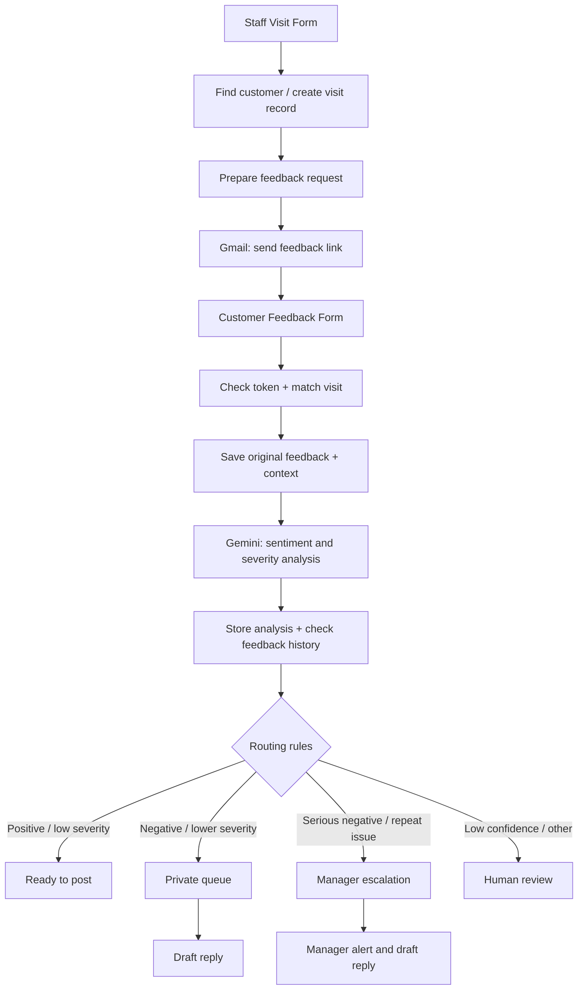
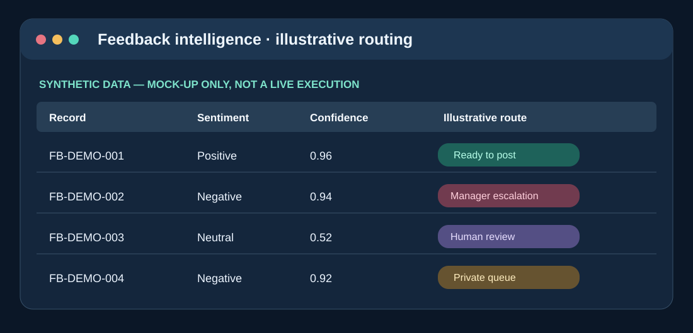

# Reputation & Feedback Intelligence Engine

**TS Academy AI & Automation Capstone · Portfolio archive (2026)**

Two interconnected n8n workflows designed around a fictional multi-location service business. Together, they demonstrate requesting customer feedback, linking it to visit records, processing responses, and routing cases for review or follow-up with **Gemini-assisted analysis**.

**Status:** Historical, sanitized workflow exports. Not a live deployment, not re-tested after archival and sanitization.

## Architecture

The diagram simplifies the flow for readability; refer to the JSON exports for the complete node wiring. Form-trigger paths are **disabled in the sanitized portfolio version**.

## Included workflows

| File | Nodes | Description |
| --- | ---: | --- |
| [Send feedback request](workflows/send-feedback-request.json) | 11 | Visit intake, feedback eligibility, request sending, visit status updates |
| [Receive customer feedback](workflows/receive-customer-feedback.json) | 31 | Form intake, matching, Google Sheets logging, Gemini analysis, score extraction, routing, drafts and escalation |

**Important architecture detail:** The historical export connects a **Gemini** chat model to the analysis path. Other OpenAI nodes are present as legacy or alternate nodes; a separately archived OpenAI recovery version was **not live-tested**. We do not claim it ran successfully.

## Illustrative demonstration

*This is an illustrative screenshot-style mock-up with synthetic data — not a real n8n execution screenshot.*

- [Synthetic feedback example CSV](examples/demo-feedback.csv)
- [Security and setup notes](SECURITY.md)

## Technologies and skills

n8n, Google Sheets, Gmail, Gemini, AI sentiment analysis, workflow automation, conditional routing, form intake, data mapping, manager escalation, and process design.

## Import and test

1. Import both workflow JSON files into an active n8n workspace.
2. **Keep all triggers disabled** until you have reviewed credentials, recipients and sheet mappings.
3. Connect your own Google Sheets, Gmail and Gemini credentials. Configure any OpenAI nodes separately if you choose to experiment with them.
4. Replace `REPLACE_WITH_GOOGLE_SHEET_ID` and the sample form URL with new test resources.
5. Verify sheet names, tab IDs, field mappings, feedback token behavior and error paths.
6. Test each scenario using synthetic data before any live customer use.
7. Confirm privacy, consent and escalation procedures appropriate for the business.

## Credible portfolio statement

The value of this project is in designing the workflow, mapping business processes to automation steps, configuring routing and connecting cloud tools. It is **not** evidence of a currently running production system or independently verified business performance.
