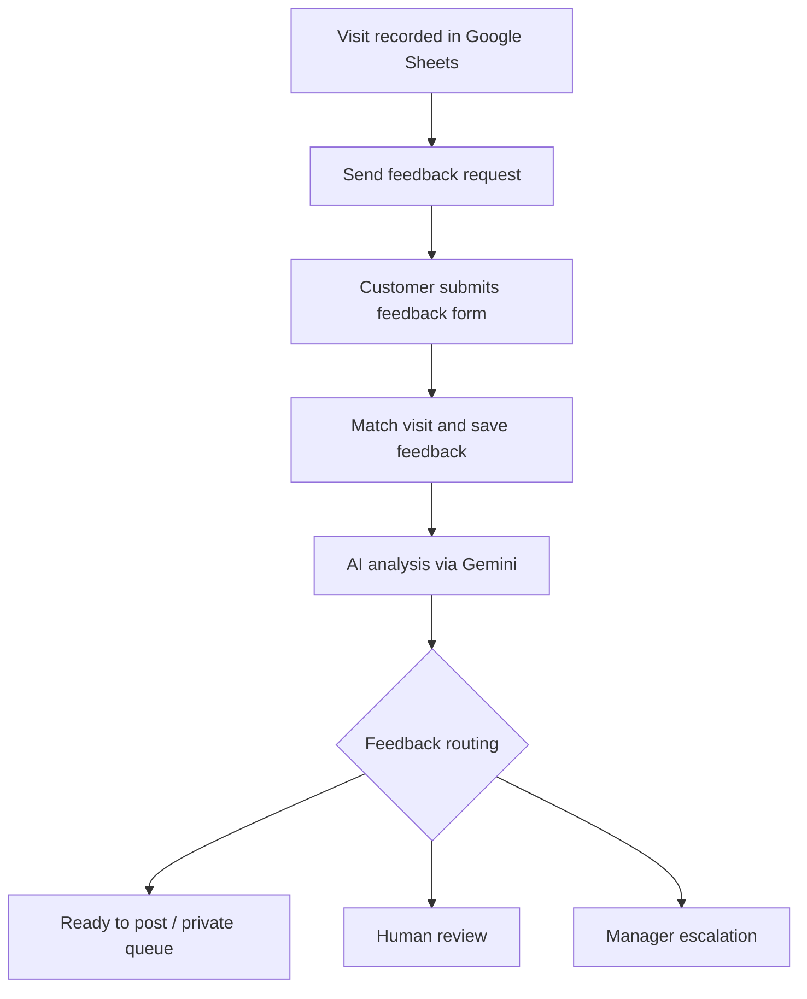

# Reputation & Feedback Intelligence Engine

**TS Academy AI & Automation capstone | Archived workflow portfolio project (2026)**

An n8n project designed to request customer feedback after a visit, link responses to visit records, analyze feedback with AI, and route follow-up actions.

## Workflow 1 — Send Feedback Request (11 nodes)

- Track staff/customer visits and feedback-request eligibility in Google Sheets.
- Prepare a feedback link and request through Gmail.
- Update request statuses in the visit records.

## Workflow 2 — Receive Customer Feedback (31 nodes)

- Receive feedback submitted through a form and match it to an existing visit.
- Update records in Google Sheets and prepare feedback context.
- Analyze sentiment and feedback via **Gemini** on the archived connected analysis route.
- Route feedback to a private queue, human review, manager escalation, or ready-to-post path.
- Draft or record follow-up responses and manager notifications.

## Technologies

n8n, Google Sheets, Gmail, Gemini, OpenAI nodes, n8n forms, JavaScript/code nodes, conditional branching.

## Workflow files

- [Send feedback request](workflows/send-feedback-request.json)
- [Receive customer feedback](workflows/receive-customer-feedback.json)

## Restore and test

1. Import both JSON workflow files into an active n8n instance.
2. Reconnect Google Sheets, Gmail and Gemini credentials; configure any OpenAI nodes you choose to use.
3. Replace the placeholder spreadsheet IDs and form URL, and verify sheet names, columns and mappings.
4. Use only fake visit/customer data for initial tests.
5. Test every route, notification and failure path before using the workflows with real people.

## Archive status and limitations

- This is a **sanitized historical export**, not a running or production-verified installation.
- The original archived Receive Customer Feedback workflow has **Gemini on the connected analysis path**. OpenAI nodes appear in the export, but a separate OpenAI recovery version was **not live-tested** and is not asserted here as deployed.
- Credentials, customer sample data, saved spreadsheet IDs and original service URLs have been stripped or replaced with placeholders.
- Importing alone does not make the workflows operational. Reconfiguration and end-to-end testing are required.

### Attribution

Built as a learner capstone project while developing practical AI and workflow automation skills.
